# Fahrzeugverwaltung / Araç Yönetimi — Kurzanleitung / Kısa Kullanım Rehberi

> Mega Cars — Website-Verwaltung. Adresse: **https://megacars-git-v2-volkancatak1309-maxs-projects.vercel.app/de/admin** (Deutsch) · **…/tr/admin** (Türkçe). Zugangsdaten erhalten Sie von Galzura.
> Mega Cars — web sitesi yönetimi. Adres: **…/tr/admin** (Türkçe) · **…/de/admin** (Almanca). Giriş bilgilerini Galzura verir.

> PDF-Version / PDF sürümü: `docs/ARAC-PANELI-REHBERI.pdf` · Screenshots / ekran görüntüleri: `docs/rehber/` (Vorschau-Adresse, 23.10.2026).

---

## Deutsch

### 1. Anmelden
1. Öffnen Sie die Adresse `/de/admin` auf dem Handy oder am Computer.
2. Geben Sie Ihre E-Mail-Adresse und Ihr Passwort ein und tippen Sie auf **Anmelden**.
3. Oben rechts wechseln Sie mit **DE / TR** die Sprache der Verwaltung; **Website** öffnet die öffentliche Seite; **Abmelden** beendet die Sitzung.

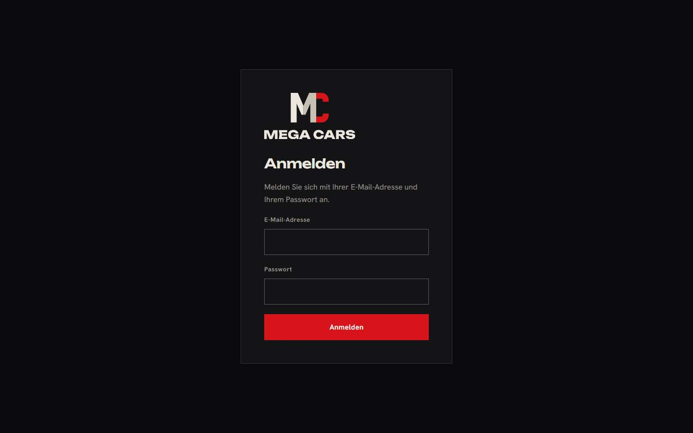

### 2. Ein Fahrzeug hinzufügen
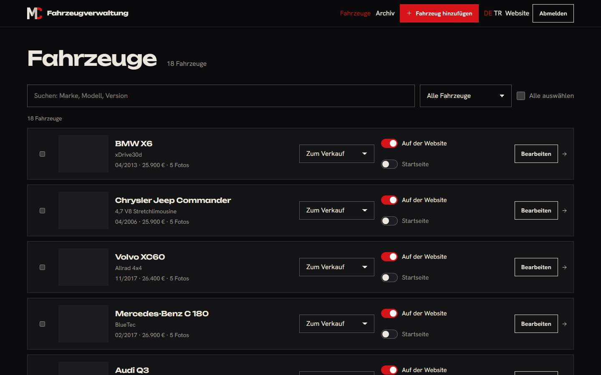

1. Tippen Sie oben auf **Fahrzeug hinzufügen**.
2. **Fotos:** Mit **Foto aufnehmen** fotografieren Sie das Auto direkt mit dem Handy; mit **Fotos auswählen** nehmen Sie Bilder aus der Galerie (mehrere auf einmal). Die Fotos werden vor dem Hochladen automatisch verkleinert; Orts- und Geräteangaben werden entfernt. Mindestens ein Foto ist nötig.
3. **Fahrzeug:** Marke und Modell wählen Sie aus der Liste oder tippen einen neuen Namen ein. Karosserie, Erstzulassung (Monat und Jahr), Kilometerstand, Preis und die Mehrwertsteuer-Angabe sind Pflicht beziehungsweise sollten gesetzt sein.
4. **Technische Daten:** Kraftstoff und Getriebe sind Pflicht. Bei der Leistung genügt ein Wert: Tragen Sie kW ein, PS wird berechnet, oder umgekehrt.
5. **Farbe und Innenraum, Zustand und Historie:** Wählen Sie aus den Listen; was Sie nicht wissen, lassen Sie auf „Keine Angabe“. Die Website zeigt dann diese Zeile nicht.
6. **Ausstattung:** Haken Sie an, was das Auto hat. Mit dem Suchfeld finden Sie einen Begriff schnell. Jede Ausstattung erscheint auf der Website automatisch auf Deutsch, Englisch und Türkisch.
7. **Vorschau** zeigt die Karte so, wie Besucher sie sehen. Mit **Speichern** ist das Fahrzeug innerhalb weniger Sekunden auf der Website.

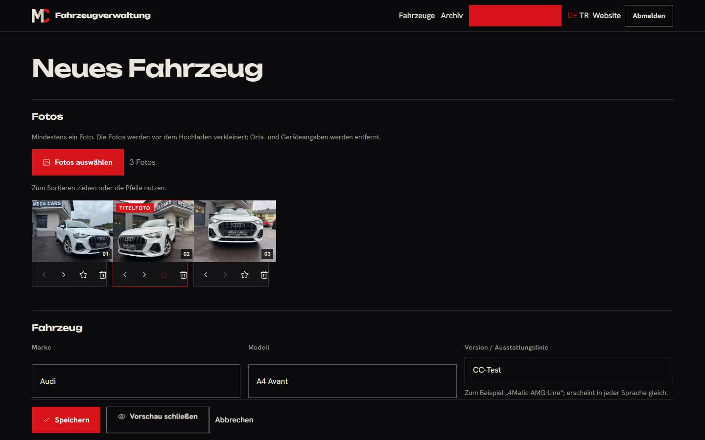

### 3. Fotos sortieren und Titelfoto wählen
- Das erste Foto ist das Titelfoto, bis Sie ein anderes wählen: Tippen Sie unter einem Foto auf den **Stern**.
- Die Reihenfolge ändern Sie mit den **Pfeilen** unter dem Foto oder am Computer durch Ziehen.
- Der **Papierkorb** entfernt ein Foto.

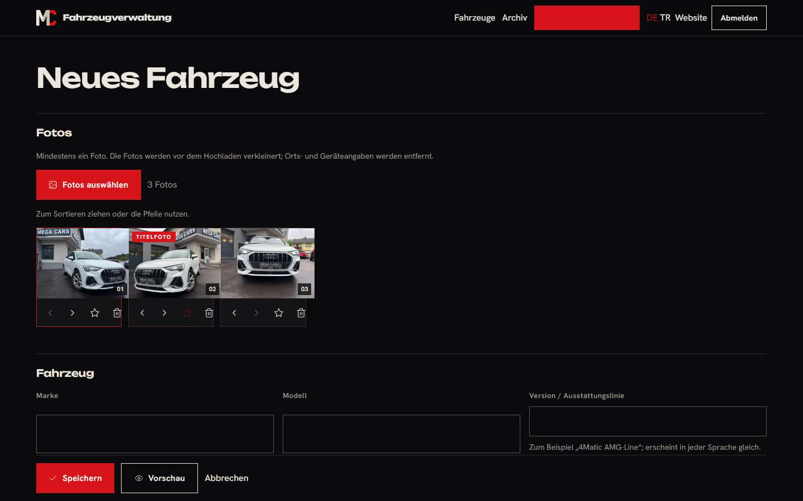

### 4. Auf der Startseite zeigen
- In der Fahrzeugliste schalten Sie **Startseite** bei einem Fahrzeug ein. Die Startseite zeigt sechs Fahrzeuge; sind weniger markiert, füllt sie mit den neuesten auf.
- Die Reihenfolge der markierten Fahrzeuge steuern Sie beim Bearbeiten unter **Reihenfolge auf der Startseite** (kleine Zahl zuerst).

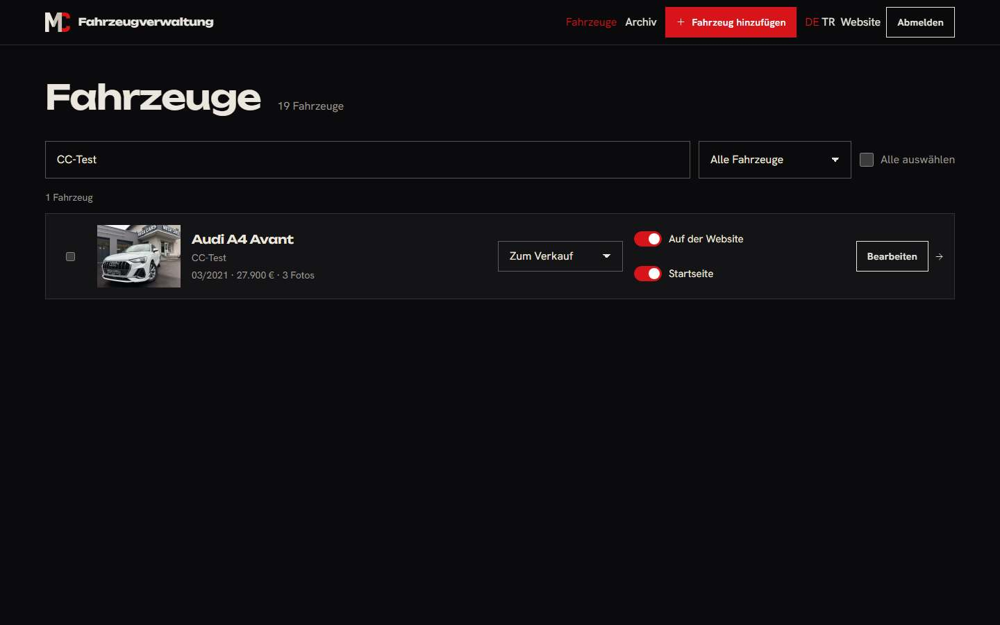

### 5. Als verkauft markieren
- In der Fahrzeugliste wählen Sie beim Fahrzeug im Menü **Status** den Eintrag **Verkauft** (oder **Reserviert**). Das Fahrzeug bleibt mit dem Hinweis „Verkauft“ auf der Website, bis Sie es ausblenden.

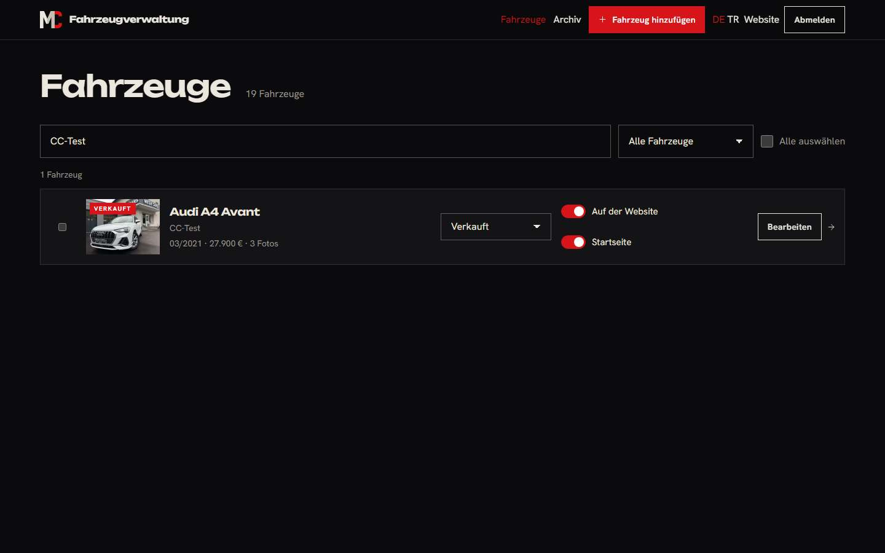

### 6. Ausblenden
- Der Schalter **Auf der Website** blendet ein Fahrzeug mit einem Tipp aus oder wieder ein. Wer den alten Link öffnet, landet automatisch in der Fahrzeugliste.
- Mehrere Fahrzeuge auf einmal: Kästchen links anhaken, dann oben **Ausblenden**, **Einblenden** oder **Archivieren**.

### 7. Archivieren und wiederherstellen
- **Archivieren** (in der Liste oder beim Bearbeiten unten) nimmt das Fahrzeug von der Website, löscht aber nichts.
- Unter **Archiv** finden Sie es wieder: **Wiederherstellen** bringt es zurück, **Endgültig löschen** entfernt es mit allen Fotos für immer (nach einer Rückfrage).

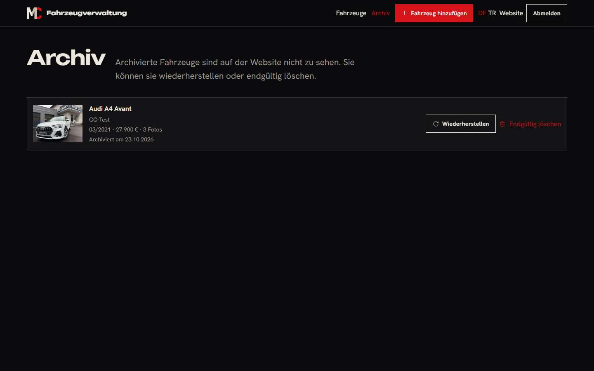

---

## Türkçe

### 1. Giriş
1. Telefonda ya da bilgisayarda `/tr/admin` adresini açın.
2. E-posta adresinizi ve şifrenizi yazıp **Giriş yap**'a dokunun.
3. Sağ üstteki **DE / TR** ile yönetim dilini değiştirirsiniz; **Web sitesi** herkese açık siteyi açar; **Çıkış yap** oturumu kapatır.

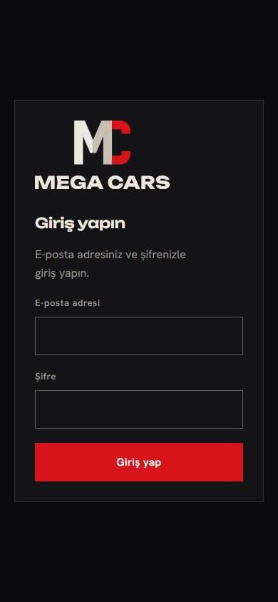

### 2. Araç ekleme
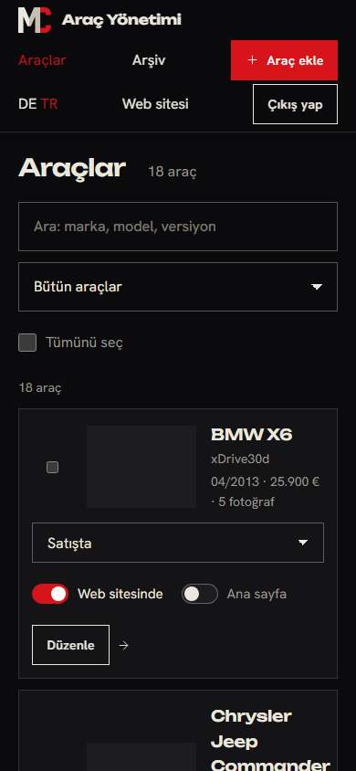

1. Üstteki **Araç ekle**'ye dokunun.
2. **Fotoğraflar:** **Fotoğraf çek** ile aracı doğrudan telefonla çekersiniz; **Fotoğraf seç** ile galeriden (birden çok) seçersiniz. Fotoğraflar yüklenmeden önce otomatik küçültülür; konum ve cihaz bilgileri silinir. En az bir fotoğraf gerekir.
3. **Araç:** Marka ve modeli listeden seçin ya da yeni bir ad yazın. Kasa tipi, ilk tescil (ay ve yıl), kilometre, fiyat ve KDV bilgisi zorunludur ya da seçilmelidir.
4. **Teknik veriler:** Yakıt ve vites zorunludur. Güç için tek değer yeter: kW yazarsanız BG hesaplanır, tersi de olur.
5. **Renk ve iç mekân, durum ve geçmiş:** Listelerden seçin; bilmediğinizi „Belirtilmedi“ bırakın. Site o satırı göstermez.
6. **Donanım:** Araçta olanları işaretleyin. Arama kutusuyla bir terimi hemen bulursunuz. Her donanım sitede otomatik olarak Almanca, İngilizce ve Türkçe görünür.
7. **Önizleme**, kartı ziyaretçinin gördüğü gibi gösterir. **Kaydet** dediğinizde araç birkaç saniye içinde sitede olur.

### 3. Fotoğrafları sıralama ve kapak seçme
- Siz başka birini seçene kadar ilk fotoğraf kapaktır: Fotoğrafın altındaki **yıldıza** dokunun.
- Sırayı fotoğrafın altındaki **oklarla**, bilgisayarda ise sürükleyerek değiştirirsiniz.
- **Çöp kutusu** fotoğrafı kaldırır.

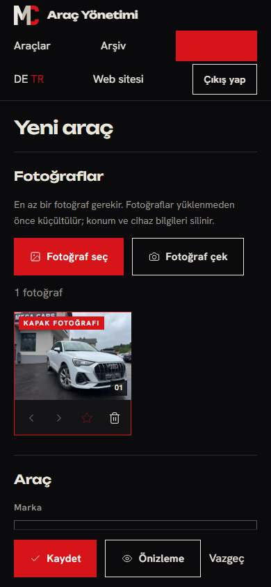

### 4. Ana sayfada gösterme
- Araç listesinde o aracın **Ana sayfa** anahtarını açın. Ana sayfa altı araç gösterir; daha azı işaretliyse boşluğu en yeni araçlarla doldurur.
- İşaretli araçların sırasını düzenleme ekranındaki **Ana sayfadaki sırası** alanından belirlersiniz (küçük sayı önce).

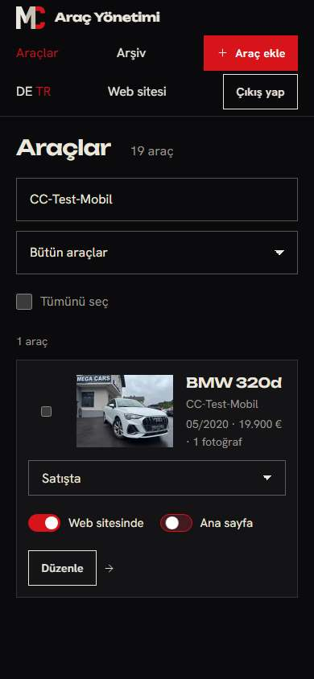

### 5. Satıldı işaretleme
- Araç listesinde aracın **Durum** menüsünden **Satıldı** (ya da **Rezerve**) seçin. Araç, siz gizleyene kadar sitede „Satıldı“ etiketiyle kalır.

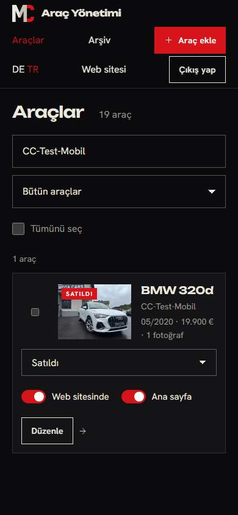

### 6. Gizleme
- **Web sitesinde** anahtarı aracı tek dokunuşla gizler ya da yeniden gösterir. Eski bağlantıyı açan ziyaretçi otomatik olarak araç listesine gider.
- Birden çok araç için: soldaki kutuları işaretleyin, sonra üstteki **Gizle**, **Göster** ya da **Arşivle**'ye dokunun.

### 7. Arşivleme ve geri alma
- **Arşivle** (listede ya da düzenleme ekranının altında) aracı siteden kaldırır ama hiçbir şeyi silmez.
- **Arşiv** sayfasında aracı yeniden bulursunuz: **Geri al** onu geri getirir, **Tamamen sil** bütün fotoğraflarıyla birlikte kalıcı olarak siler (onay sorduktan sonra).

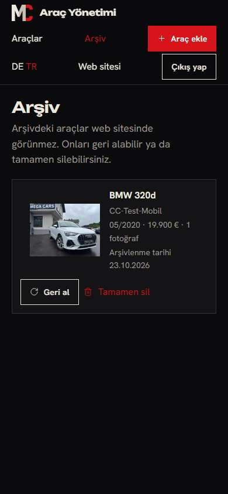
