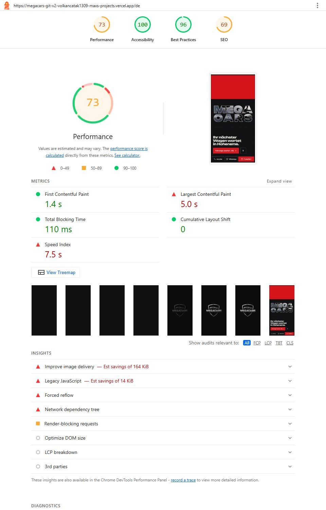
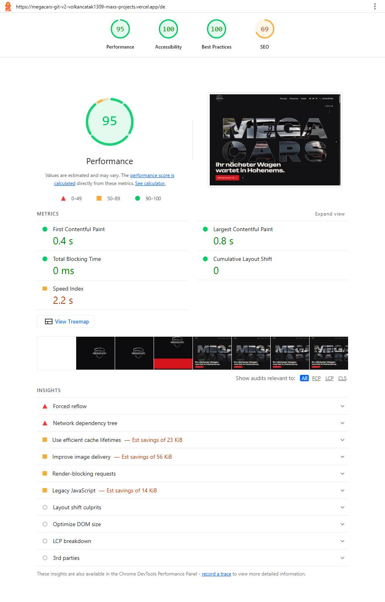

# LIGHTHOUSE — Mega Cars v2 (önizleme)

> **Ölçüm: 29.10.2026, commit f823edc** (Panamera kasa tipi + hareket azaltma / tarih alanı düzeltmeleri dahil). Sabit önizleme adresi https://megacars-git-v2-volkancatak1309-maxs-projects.vercel.app (girişsiz, noindex). Lighthouse 13.5.0 CLI, headless Chrome, varsayılan simüle kısıtlama (mobil: Moto G Power, yavaş 4G, 4× CPU; masaüstü: `--preset=desktop`). Her sayfa ve cihaz için **3 ölçüm, sırayla (aynı anda değil)**; tablodaki değerler **ortanca**. Ham JSON ve HTML raporları: `_work/finish/lh/` (repoya girmez), betik `_work/finish/lh.py`.
> Volkan'ın 29.10.2026 talimatı: **yalnız ölç, hız iyileştirmesi yapma.** Volkan'ın 23.10.2026 kararıyla bu sitede hız işleriyle uğraşılmıyor; mobil LCP < 3,0 sn hedefi askıda.
> Hedefler (KARAR-DEFTERI 22.10.2026, bilgi için): mobil Performans ≥ 80, masaüstü ≥ 85, mobil LCP < 3,0 sn, CLS < 0,1, ilk yük JS < 300 KB (gzip).
> \* SEO bilerek düşük: site canlıya çıkana kadar `noindex` + `robots.txt Disallow: /` (Lighthouse "is-crawlable"). Canlıya geçişte `lib/launch.ts` → `INDEXABLE = true`.

## Mobil (29.10.2026)

| Sayfa | Performans | LCP (sn) | CLS | TBT (ms) | FCP (sn) | Speed Index (sn) | Erişilebilirlik | En iyi uyg. | SEO* | İlk yük JS gzip (KB) | 3 ölçüm (Perf / LCP) |
|---|---|---|---|---|---|---|---|---|---|---|---|
| Ana sayfa /de | 73 ✗ | 4,99 ✗ | 0 ✓ | 110 | 1,29 | 7,55 | 100 | 96 | 69 | 230,7 ✓ | 73 / 4,99 · 74 / 4,92 · 73 / 5,00 |
| Araç listesi /de/fahrzeuge | 75 ✗ | 5,62 ✗ | 0 ✓ | 22 | 1,26 | 5,12 | 100 | 96 | 69 | 231,2 ✓ | 75 / 5,79 · 75 / 5,62 · 76 / 5,53 |
| Araç detayı (S 560) | 74 ✗ | 5,02 ✗ | 0,014 ✓ | 55 | 1,27 | 7,80 | 100 | 100 | 69 | 231,7 ✓ | 81 / 4,27 · 73 / 5,15 · 74 / 5,02 |
| İletişim /de/kontakt | 77 ✗ | 4,39 ✗ | 0 ✓ | 58 | 1,27 | 7,10 | 100 | 100 | 69 | 228,4 ✓ | 78 / 4,35 · 77 / 4,50 · 77 / 4,39 |

## Masaüstü (29.10.2026)

| Sayfa | Performans | LCP (sn) | CLS | TBT (ms) | FCP (sn) | Speed Index (sn) | Erişilebilirlik | En iyi uyg. | SEO* | İlk yük JS gzip (KB) | 3 ölçüm (Perf / LCP) |
|---|---|---|---|---|---|---|---|---|---|---|---|
| Ana sayfa /de | 95 ✓ | 0,96 | 0 ✓ | 0 | 0,35 | 2,08 | 100 | 96 | 69 | 236,0 ✓ | 95 / 0,84 · 93 / 1,22 · 95 / 0,96 |
| Araç listesi /de/fahrzeuge | 90 ✓ | 1,54 | 0 ✓ | 0 | 0,33 | 2,24 | 100 | 96 | 69 | 236,5 ✓ | 90 / 1,54 · 94 / 0,93 · 88 / 1,71 |
| Araç detayı (S 560) | 92 ✓ | 1,32 | 0 ✓ | 0 | 0,34 | 2,02 | 100 | 100 | 69 | 237,0 ✓ | 92 / 1,38 · 95 / 1,01 · 92 / 1,32 |
| İletişim /de/kontakt | 96 ✓ | 0,75 | 0 ✓ | 0 | 0,34 | 1,92 | 100 | 96 | 69 | 233,7 ✓ | 96 / 0,75 · 95 / 1,05 · 96 / 0,72 |

## Ekran görüntüleri (ortanca ölçümün raporu)

Mobil: [ana sayfa](lighthouse/2026-10-29/startseite-mobile.jpg) · [araç listesi](lighthouse/2026-10-29/fahrzeuge-mobile.jpg) · [araç detayı](lighthouse/2026-10-29/detail-s560-mobile.jpg) · [iletişim](lighthouse/2026-10-29/kontakt-mobile.jpg)
Masaüstü: [ana sayfa](lighthouse/2026-10-29/startseite-desktop.jpg) · [araç listesi](lighthouse/2026-10-29/fahrzeuge-desktop.jpg) · [araç detayı](lighthouse/2026-10-29/detail-s560-desktop.jpg) · [iletişim](lighthouse/2026-10-29/kontakt-desktop.jpg)

## Okuma notları (ölçüm; düzeltme yapılmadı)

- **Mobil LCP 4,4–5,6 sn:** ölçülen gecikmenin büyük kısmı "element render delay" (ana sayfa 2,2 sn, detay 2,0 sn, iletişim 2,4 sn). Lighthouse her ölçümü ilk ziyaret sayar; logolu açılış ekranı ilk ≈ 2 sn sayfayı örter (film şeridinde logo görünür, sonra sayfa). LCP öğesi: ana sayfa = açılış bölümündeki "MEGA CARS" harfleri, liste = açılış ekranındaki logo, detay = aracın kapak fotoğrafı, iletişim = adres satırı. 23.10.2026'daki ölçüme (sayaçlı yükleyici, eski film) göre mobil LCP 1,3–2,9 sn arttı, mobil Performans 84–91'den 73–77'ye indi; masaüstü 90–96 aralığında kaldı.
- **En iyi uygulamalar 96 (ana sayfa, liste, iletişim):** tek eksik "image-aspect-ratio" — üst bardaki logonun 96 ve 160 px'lik WebP dosyaları piksel yuvarlaması yüzünden 1,22 / 1,21 oranında (asıl logo 1,21). Logo dosyalarına dokunulmadı (Volkan: logo değişmez).
- **Erişilebilirlik 100 (8/8):** puana sayılmayan "label-content-name-mismatch" denetimi masaüstünde üst bardaki telefon bağlantısında başarısızdı (görünen numara erişilebilir adın başında değildi). 6a26281 ile düzeltildi; önizlemede yeniden ölçüldü: /de ve /de/kontakt'ta denetim artık uygulanamaz (etiket yok, ad görünen numarayla başlıyor), erişilebilirlik 100.
- Konsol hatası her 24 ölçümde 0. İlk yük JS 228–237 KB (gzip -9 ile yeniden sıkıştırılmış).
- Vercel önizlemesi `vercel.live` araç çubuğu betiğini ekler; üretim adresinde bu betik yoktur.

## Önceki ölçüm — 23.10.2026 (commit 38f09d0; sayaçlı yükleyici ve Corvette filmiyle)

Mobil Performans / LCP: ana sayfa 84 / 3,40 · liste 91 / 2,73 · detay 78 / 3,69 · Kontakt 89 / 2,58 · Finanzierung 87 / 3,23 · Ankauf 82 / 3,38 · Impressum 92 / 2,46 · Datenschutz 87 / 3,11. Masaüstü 92–97, LCP ≤ 1,24 sn. Erişilebilirlik ve en iyi uygulamalar her sayfada 100; SEO 66–69 (noindex). Ham veriler `_work/faz5/lh/`.

INP (23.10.2026, Chrome mobil öykünme, 4× CPU, Event Timing API, en kötü etkileşim): galeride "Nächstes Foto" 72 ms · küçük resme dokunma 48 ms · liste "Filter" panelini açma 224–272 ms · menüyü açma 272–288 ms (1× CPU'da 40 ms) · "Probefahrt anfragen" penceresi 296 ms (1× CPU'da 40 ms). Modal açan düğmelerde `dialog.showModal()` bütün belgenin stilini yeniden hesaplatıyor. Volkan'ın 29.10.2026 kararıyla bu madde yapılmayacak (hız işi).
